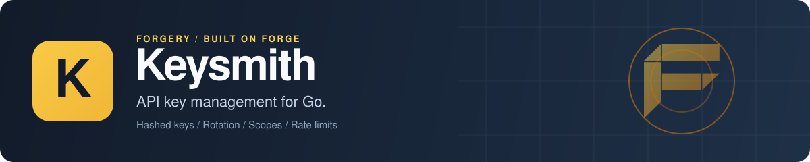

<p align="center">
  
</p>

# Keysmith: API key management for Go

Keysmith is a Go library for API key management. You create, validate, rotate, suspend and revoke API keys, give them permission scopes and policies (rate limits, lifetimes, rotation grace periods), and record usage, all scoped to a tenant. The store only ever holds a SHA-256 hash and the last four characters, so the raw key exists in exactly one place: the result you get back from create or rotate. It works on its own with `net/http` middleware, or as a [Forge](https://github.com/xraph/forge) extension with an admin REST API.

[](https://go.dev/dl/) [](https://github.com/xraph/keysmith/actions/workflows/ci.yml) [](https://pkg.go.dev/github.com/xraph/keysmith) [](https://github.com/xraph/keysmith/stargazers)

[Documentation](https://www.xraph.com/docs/keysmith) · [Quick start](#quick-start) · [Features](#why-keysmith) · [Middleware](#protect-http-routes) · [Policies](#policies-and-scopes) · [Forge](#use-it-with-forge) · [REST API](#rest-api) · [FAQ](#faq)

## Quick start

You need [Go 1.26 or later](https://go.dev/dl/).

```bash
go get github.com/xraph/keysmith@latest
```

Save this as `main.go`. It creates a key for one tenant, validates it, then rotates it with a one-hour grace window:

```go
package main

import (
	"context"
	"fmt"
	"log"
	"time"

	"github.com/xraph/keysmith"
	"github.com/xraph/keysmith/key"
	"github.com/xraph/keysmith/rotation"
	"github.com/xraph/keysmith/scope"
	"github.com/xraph/keysmith/store/memory"
)

func main() {
	eng, err := keysmith.NewEngine(keysmith.WithStore(memory.New()))
	if err != nil {
		log.Fatal(err)
	}

	ctx := keysmith.WithTenant(context.Background(), "billing", "acme")

	// Scopes are defined per tenant before a key can carry them.
	if err := eng.CreateScope(ctx, &scope.Scope{Name: "deploy:write"}); err != nil {
		log.Fatal(err)
	}

	// The raw key only exists in this result. The store keeps a hash.
	created, err := eng.CreateKey(ctx, &keysmith.CreateKeyInput{
		Name:        "CI deploy key",
		Prefix:      "ak",
		Environment: key.EnvTest,
		Scopes:      []string{"deploy:write"},
	})
	if err != nil {
		log.Fatal(err)
	}
	fmt.Println("created key ending in", created.Key.Hint)

	res, err := eng.ValidateKey(ctx, created.RawKey)
	if err != nil {
		log.Fatal(err)
	}
	fmt.Println("tenant:", res.Key.TenantID, "scopes:", res.Scopes)

	// Rotate, and keep the old key working for an hour.
	rotated, err := eng.RotateKey(ctx, created.Key.ID, rotation.ReasonScheduled, keysmith.WithGrace(time.Hour))
	if err != nil {
		log.Fatal(err)
	}

	old, err := eng.ValidateKey(ctx, created.RawKey)
	if err != nil {
		log.Fatal(err)
	}
	fmt.Println("old key still valid:", old.ViaPreviousKey, "new key ends in", rotated.Key.Hint)
}
```

Run it:

```bash
go mod tidy
go run .
# created key ending in e918
# tenant: acme scopes: [deploy:write]
# old key still valid: true new key ends in 702a
```

Your hints will differ. Hand `created.RawKey` to your user once, show them the hint from then on, and if they lose the key, you rotate it, because there is no way to read it back out of the store and that's the whole point of hashing it.

Keys look like `<prefix>_<environment>_<64 hex characters>`, where the environment is `key.EnvLive`, `key.EnvTest` or `key.EnvStaging`. Want a different format or hash? Pass your own with `keysmith.WithKeyGenerator` or `keysmith.WithHasher`.

## Why Keysmith?

Issuing an API key is easy. Running them for years is the part that hurts: you need to rotate a leaked key without breaking every client at once, know which tenant a key belongs to, cap what it can do, and prove what happened to it. Keysmith handles that lifecycle so your handlers only have to ask "is this key valid, and what can it do?".

| You need | Keysmith gives you |
| --- | --- |
| Keys you never store in plain text | A SHA-256 hash in the store, plus a four-character hint you can show in a UI |
| Rotation without an outage | `RotateKey` with a grace window, from `WithGrace`, the key's policy, or 24 hours by default |
| A full key lifecycle | Create, validate, rotate, suspend, reactivate, revoke and expire, with `ErrKeyInactive`, `ErrKeyExpired` and friends to tell them apart |
| Permission scopes | Per-tenant scopes assigned to keys, returned on validation, and checked by `RequireScopes` middleware |
| Limits per key | Policies with rate limits (through a `RateLimiter` you supply), a maximum key lifetime, allowed scopes and a rotation grace period |
| Usage analytics | Per-request usage records with daily and monthly aggregation |
| Multi-tenant isolation | Tenant and app from Forge's scope or from `keysmith.WithTenant` |
| Your database | PostgreSQL, SQLite and MongoDB through [Grove](https://github.com/xraph/grove), and an in-memory store |
| Hooks for audit and metrics | Lifecycle hooks with ready-made audit, metrics and [Warden](https://github.com/xraph/warden) bridges |
| To see what it's doing | OpenTelemetry spans for validation and every key state change, and six metrics on Forge's `/_/metrics`, with no key material, IDs or tenants on any of them |

## Protect HTTP routes

The `middleware` package works with any `net/http` router. `APIKeyAuth` reads the key from `Authorization: Bearer ...` or `X-API-Key`, validates it, and puts the result on the request context. `RequireScopes` then checks the key holds every scope you list.

```go
mux := http.NewServeMux()
mux.Handle("POST /deploy",
	middleware.APIKeyAuth(eng)(
		middleware.RequireScopes("deploy:write")(deployHandler),
	),
)
```

Inside the handler, `middleware.ResultFromContext(r.Context())` gives you the `*keysmith.ValidationResult` with the key, its scopes and its policy. The middleware answers `ErrRateLimited` with a 429 and `ErrKeyExpired` with a 403. Everything else, a missing key, an unknown one, a suspended or revoked one, gets a 401. If a client presented a key that was rotated but is still inside its grace window, `ViaPreviousKey` is true and `GraceEnds` tells you when it stops working, which is a good moment to warn them.

## Policies and scopes

A policy is a named set of limits in a tenant. You create one with `eng.CreatePolicy(ctx, &policy.Policy{...})` and attach it to a key through `CreateKeyInput.PolicyID`. These fields are enforced today:

| Policy field | Where it's enforced |
| --- | --- |
| `RateLimit`, `RateLimitWindow` | On every `ValidateKey`, when you passed a `RateLimiter` with `keysmith.WithRateLimiter`. Without one the limit is stored and never checked, and `eng.RateLimiterConfigured()` tells you which case you're in |
| `MaxKeyLifetime` | On `CreateKey`. An expiry beyond it is refused, and a key with no expiry gets one at the cap |
| `AllowedScopes` | On `CreateKey` and `AssignScopes`. A key can't carry a scope the policy doesn't list |
| `GracePeriod` | On `RotateKey`, when you don't pass `WithGrace` |

The policy also stores `AllowedIPs`, `AllowedOrigins`, `AllowedMethods`, `AllowedPaths`, `BurstLimit`, `DailyQuota`, `MonthlyQuota` and `RotationPeriod`, and returns them on validation, but Keysmith doesn't enforce them yet. If you need any of them now, read them off `res.Policy` in your handler after validation and enforce them there, since the validation result hands you the whole policy along with the key and its scopes.

Scopes are plain names. Each tenant has its own set (`deploy:write`, `billing:read`), and a scope can name a parent. Create them with `CreateScope`, then attach them with `CreateKeyInput.Scopes` or `AssignScopes`.

## Usage and rotation history

Record a request against a key with `eng.RecordUsage(ctx, &usage.Record{...})`, carrying the endpoint, method, status code, IP and latency. Read them back with `QueryUsage`, or roll them up by day or month with `AggregateUsage`. Every rotation leaves a `rotation.Record` you can list with `ListRotations`.

`CleanupExpiredKeys` marks keys past their expiry as expired. `EndGrace` closes a rotated key's grace window early, which is what you want when the old key leaked.

## Storage backends

Every backend implements `store.Store`, with `Keys()`, `Policies()`, `Usages()`, `Rotations()` and `Scopes()` plus `Migrate`, `Ping` and `Close`.

| Backend | Package | Constructor |
| --- | --- | --- |
| In-memory | `store/memory` | `memory.New()` |
| PostgreSQL | `store/postgres` | `postgres.New(db *pgdriver.PgDB)` or `postgres.NewFromDSN(ctx, dsn)` |
| SQLite | `store/sqlite` | `sqlite.New(db *grove.DB)`; open the database with `sqlite.DSN(path)` |
| MongoDB | `store/mongo` | `mongo.New(db *grove.DB)` |

Call `Migrate(ctx)` before first use, or let the Forge extension do it. For SQLite, build the DSN with `sqlite.DSN` so you get a busy timeout and foreign keys. Without them a write can fail with `SQLITE_BUSY` under load.

## Hooks

Pass hooks to the engine with `keysmith.WithExtension`. A hook implements `plugin.Plugin` (just `Name()`) and any of these: `KeyCreated`, `KeyCreateFailed`, `KeyValidated`, `KeyValidationFailed`, `KeyRotated`, `KeyRevoked`, `KeySuspended`, `KeyReactivated`, `KeyExpired`, `KeyRateLimited`, `PolicyCreated`, `PolicyUpdated`, `PolicyDeleted` and `Shutdown`.

Three come with the library:

| Package | Constructor | What it does |
| --- | --- | --- |
| `audit_hook` | `audithook.New(recorder)` | Sends lifecycle events to any `Recorder`, such as an adapter over [Chronicle](https://github.com/xraph/chronicle) |
| `observability` | `observability.NewMetricsExtension()` | Counts lifecycle events as unlabelled go-utils counters. The engine's own metrics (below) cover the same ground |
| `warden_hook` | `wardenhook.New(bridge)` | Keeps Warden role assignments for API key subjects in sync |

The audit and Warden hooks each declare a small local interface, so Keysmith never imports Chronicle or Warden.

## Use it with Forge

The `extension` package registers Keysmith as a [Forge extension](https://github.com/xraph/forge#extensions). It reads `extensions.keysmith` (or a legacy top-level `keysmith` key), builds a store from the `*grove.DB` in the container, provides `*keysmith.Engine` for injection, mounts the REST API under `/keysmith`, and runs `Migrate` on start.

```bash
go get github.com/xraph/keysmith@latest github.com/xraph/grove/extension@latest
```

```go
import (
	grove "github.com/xraph/grove/extension"
	audithook "github.com/xraph/keysmith/audit_hook"
	keysmith "github.com/xraph/keysmith/extension"
)

// Send key lifecycle events wherever your audit trail lives.
recorder := audithook.RecorderFunc(func(ctx context.Context, ev *audithook.AuditEvent) error {
	log.Printf("keysmith audit: %s %s", ev.Action, ev.ResourceID)
	return nil
})

app := forge.NewApp(forge.AppConfig{
	Name: "billing-api",
	Extensions: []forge.Extension{
		grove.New(), // extensions.grove: driver and dsn
		keysmith.New(
			keysmith.WithHookExtension(audithook.New(recorder)),
		),
	},
})
```

List Grove first, because Keysmith looks up the database during `Register`. Without a Grove database, pass a store yourself with `keysmith.WithEngineOptions(keysmith.WithStore(...))` from the root package. [Authsome](https://github.com/xraph/authsome) takes the same engine through `authsome.WithKeysmith`.

The REST API has no authentication of its own. Put your auth middleware in front of the `/keysmith` group, or turn the routes off with `disable_routes` and call the engine from your own handlers.

## Tracing and metrics

In a Forge app there's nothing to set up. Forge installs the tracer provider, and the extension hands the engine `app.Metrics()`, so you get these spans under each request's server span and these series on `/_/metrics`:

| Span | Attributes |
| --- | --- |
| `validate key`, with a `check rate limit` child when a limiter runs | `keysmith.result`, `keysmith.validation.via_previous_key` |
| `create key`, `rotate key`, `revoke key`, `suspend key`, `reactivate key` | `keysmith.result`, plus the rotation reason and grace window on `rotate key` |
| `expire keys`, one root span per `CleanupExpiredKeys` run that finds work | `keysmith.keys.expired`, `keysmith.keys.failed` |

| Metric | Labels |
| --- | --- |
| `forge_keysmith_key_validations_total` | `result` (`ok`, `invalid`, `inactive`, `expired`, `rate_limited`, `cancelled`, `error`), `via_previous_key` |
| `forge_keysmith_key_validation_duration_seconds` | `result` |
| `forge_keysmith_key_operations_total` | `operation` (`create`, `rotate`, `revoke`, `suspend`, `reactivate`, `expire`), `result` (`ok`, `not_found`, `rejected`, `conflict`, `cancelled`, `error`) |
| `forge_keysmith_rate_limit_checks_total` | `result` (`allowed`, `denied`, `cancelled`, `error`) |
| `forge_keysmith_hook_errors_total` | `event`, one per lifecycle hook |
| `forge_keysmith_last_used_updates_failed_total` | none |

Without Forge, pass `keysmith.WithMetrics(m)` with any go-utils metrics sink and set a global tracer provider. A store outage during validation still answers `ErrInvalidKey`, but it's recorded as `result="error"`, so it won't hide among bad keys. A client that hangs up is `cancelled`, so it doesn't count as an outage. The [observability docs](https://www.xraph.com/docs/keysmith/subsystems/observability) list every attribute and label value.

## Configuration

```yaml
extensions:
  keysmith:
    base_path: /keysmith
    disable_routes: false
    disable_migrate: false
    grove_database: primary     # optional; the default *grove.DB otherwise
    dashboard:
      tenant_id: acme           # tenant for dashboard sessions with no org
      app_id: billing
```

| Key | Option | Default |
| --- | --- | --- |
| `base_path` | `WithBasePath(path)` | `/keysmith` |
| `disable_routes` | `WithDisableRoutes()` | `false` |
| `disable_migrate` | `WithDisableMigrate()` | `false` |
| `grove_database` | `WithGroveDatabase(name)` | the default `*grove.DB` |
| `dashboard.tenant_id`, `dashboard.app_id` | `WithDashboardTenant(tenantID, appID)` | empty, so a dashboard session without an org is refused |

`WithEngineOptions`, `WithHookExtension`, `WithLogger`, `WithConfig` and `WithRequireConfig` round out the options. The Forge dashboard shows Keysmith through a React plugin in forge-dashboard; read [MIGRATION.md](MIGRATION.md) before you upgrade from the templ dashboard.

## REST API

With the Forge extension, these routes sit under the base path (`/keysmith` by default):

| Area | Routes |
| --- | --- |
| Keys | `POST /v1/keys`, `GET /v1/keys`, `GET /v1/keys/:keyId`, `DELETE /v1/keys/:keyId` |
| Key state | `POST /v1/keys/:keyId/rotate`, `/revoke`, `/suspend`, `/reactivate` |
| Validation | `POST /v1/keys/validate` |
| Policies | `POST /v1/policies`, `GET /v1/policies`, `GET`, `PUT` and `DELETE /v1/policies/:policyId` |
| Scopes | `POST /v1/scopes`, `GET /v1/scopes`, `DELETE /v1/scopes/:scopeId`, `POST` and `DELETE /v1/keys/:keyId/scopes` |
| Usage | `GET /v1/keys/:keyId/usage`, `GET /v1/keys/:keyId/usage/aggregate`, `GET /v1/usage` |
| Rotations | `GET /v1/keys/:keyId/rotations` |

Every route carries OpenAPI metadata, so it shows up in your Forge app's spec. The [REST API reference](https://www.xraph.com/docs/keysmith/api-reference/rest-api) has the request and response shapes.

## Documentation

| Topic | Where |
| --- | --- |
| Getting started | [Getting started](https://www.xraph.com/docs/keysmith/getting-started), [architecture](https://www.xraph.com/docs/keysmith/architecture), [full example](https://www.xraph.com/docs/keysmith/guides/full-example) |
| Subsystems | [Keys](https://www.xraph.com/docs/keysmith/subsystems/keys), [policies](https://www.xraph.com/docs/keysmith/subsystems/policies), [scopes](https://www.xraph.com/docs/keysmith/subsystems/scopes), [rotation](https://www.xraph.com/docs/keysmith/subsystems/rotation), [usage](https://www.xraph.com/docs/keysmith/subsystems/usage), [plugins](https://www.xraph.com/docs/keysmith/subsystems/plugins), [observability](https://www.xraph.com/docs/keysmith/subsystems/observability) |
| Storage | [PostgreSQL](https://www.xraph.com/docs/keysmith/stores/postgres), [SQLite](https://www.xraph.com/docs/keysmith/stores/sqlite), [MongoDB](https://www.xraph.com/docs/keysmith/stores/mongo), [memory](https://www.xraph.com/docs/keysmith/stores/memory), [custom store](https://www.xraph.com/docs/keysmith/guides/custom-store) |
| Integration | [Forge extension](https://www.xraph.com/docs/keysmith/guides/forge-extension), [middleware](https://www.xraph.com/docs/keysmith/guides/middleware), [multi-tenancy](https://www.xraph.com/docs/keysmith/concepts/multi-tenancy) |

The Go API is on [pkg.go.dev](https://pkg.go.dev/github.com/xraph/keysmith).

## Examples

| Example | What it shows |
| --- | --- |
| [basic](_examples/basic/) | The engine on its own with the memory store |
| [forge](_examples/forge/) | Keysmith as a Forge extension |

Run one from the repository root with `GOWORK=off go run ./_examples/basic`.

## FAQ

### How do I generate and validate API keys in Go?

Create an engine with a store, call `CreateKey` to get the raw key once, and call `ValidateKey` with whatever the client sends you. For HTTP services, wrap your handlers in `middleware.APIKeyAuth`.

### How do I rotate an API key without breaking clients?

Call `RotateKey` with a grace window. The old key keeps validating until the window ends, and the validation result tells you when a client is still using it. For a leaked key, rotate with `rotation.ReasonCompromise` and close the window with `EndGrace`, or revoke the key outright.

### Does Keysmith store API keys in plain text?

No. It stores a SHA-256 hash and the last four characters. The raw key only appears in what `CreateKey` and `RotateKey` return.

### Can Keysmith rate limit API keys?

Yes, when you give the engine a `RateLimiter` with `keysmith.WithRateLimiter` and the key's policy sets `RateLimit`. Keysmith defines the interface, so you can back it with Redis or anything else you already run.

### Can I use Keysmith without Forge?

Yes. The engine, the stores and the middleware are plain Go and `net/http`. The `extension` package is only there for Forge apps.

## Contributing

Issues and focused pull requests are welcome on [GitHub](https://github.com/xraph/keysmith/issues).

```bash
git clone https://github.com/xraph/keysmith.git
cd keysmith
GOWORK=off go test ./...       # memory and sqlite
make test-backends             # adds postgres and mongo in Docker
GOWORK=off go vet ./...
golangci-lint run ./...
```

Without `KEYSMITH_TEST_PG_DSN` or `KEYSMITH_TEST_MONGO_URI`, the PostgreSQL and MongoDB subtests are never created, so `go test -v` won't even print a SKIP for them. `make test-backends` starts the containers and sets both for you. Don't write a full fake key as one string literal in a test: one shaped like a live payment provider key trips GitHub push protection, so build it from parts. [AGENTS.md](AGENTS.md) explains that, the lint rules that bite and the release steps. Commits follow [Conventional Commits](https://www.conventionalcommits.org/).

## License

MIT. See [LICENSE](LICENSE).

Keysmith is part of the [Forge](https://github.com/xraph/forge) forgery stack, built by [Rex Raphael](https://github.com/juicycleff) and [contributors](https://github.com/xraph/keysmith/graphs/contributors).
